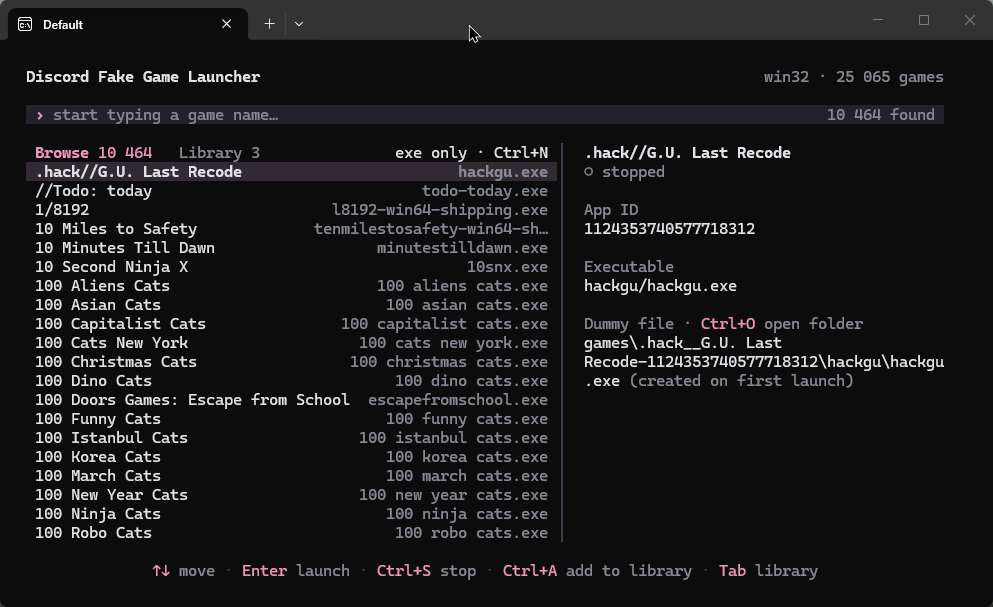

# discord-fake-game-launcher (rust, tui)

rewrite of [Jeardey/discord-fake-game-launcher](https://github.com/Jeardey/discord-fake-game-launcher) in rust
the idea and the logic are not mine, all credit goes to the original author. i just wanted something smaller and faster, and some rust practice

you pick a game from discord's detectable list, the launcher runs a tiny fake process with that game's
exe name, and discord shows it as your activity. one exe instead of three projects + electron,
and it takes about 2 mb instead of 250+ mb

personal use only, mind discord's tos



## build

```
cargo build --release
```

needs rust 1.85+. the exe is in `target/release/`.

## controls

just type to search. everything else is on ctrl:

| key | action |
|---|---|
| `Enter` | launch (also adds the game to library) |
| `Ctrl+S` | stop |
| `Tab` | browse / library |
| `Ctrl+A` | add to library and create the dummy file (browse) |
| `Ctrl+F` | favorite (library) |
| `Ctrl+D` | remove from library and delete the dummy file (library) |
| `Ctrl+N` | show games without a known exe |
| `Ctrl+O` | open the data folder |
| `Esc` | clear search |
| `Ctrl+C`, `Ctrl+Q` | quit (fake games stop too) |

## notes

- the game list is downloaded from discord on every start in the background, the cached copy is used until it finishes
- data lives in `%APPDATA%/discord-fake-game-launcher-tui` (`~/.config/...` on linux): `gamelist.json`, `myGames.json` and the `games` folder with dummy files
- `myGames.json` has the same format as the electron version, just copy it over to keep your library
- `dummy/dummy.rs` is the fake game, `build.rs` compiles it and embeds it into the launcher
- tested on windows only
- no auto-update